# Using the workbench, step by step

A reconciliation of 20 people against Wikidata through the ECHOLOT service, from an empty
workspace to reviewed results. Recorded on 2026-10-27 with Claude Sonnet 5.5 (through OpenRouter),
the local executor and the demo file `demo/people-demo.csv`. The agent's wording differs from run
to run. To record the set again, see `apps/web/scripts/usage-screenshots.mjs`.

The screen has three panes: your files, task notes, script and runs on the left; whatever is
open in the middle; the chat with the agent on the right.

## 1. Start a workspace

| | |
|---|---|
| 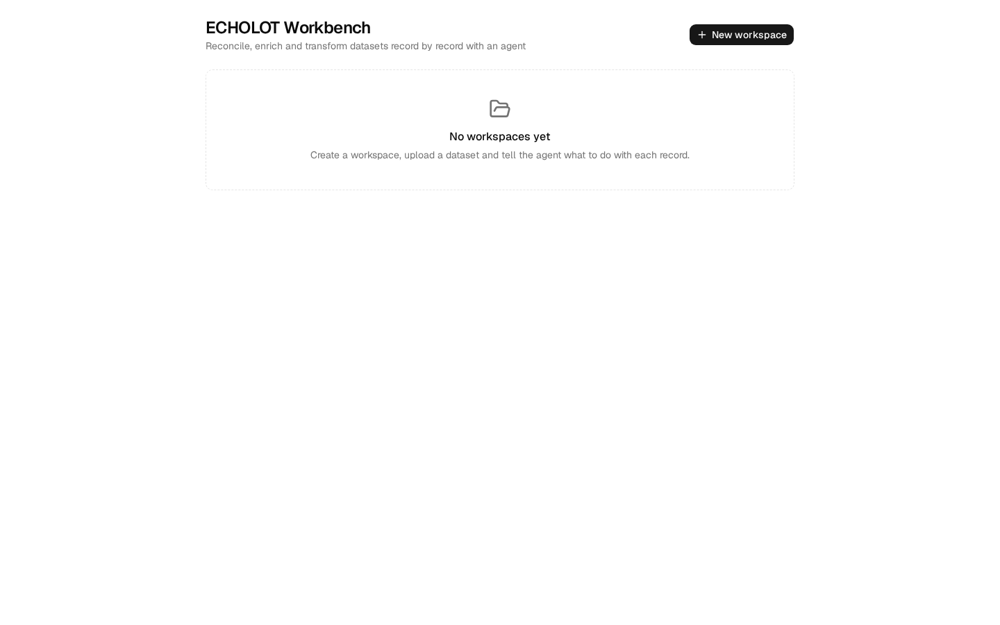 | **Workspaces.** One workspace per dataset and task. |
| 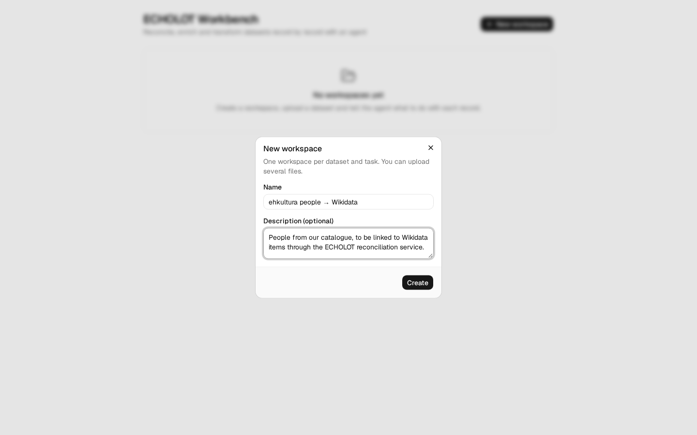 | **New workspace.** A name, and optionally a description the agent reads too. |
| 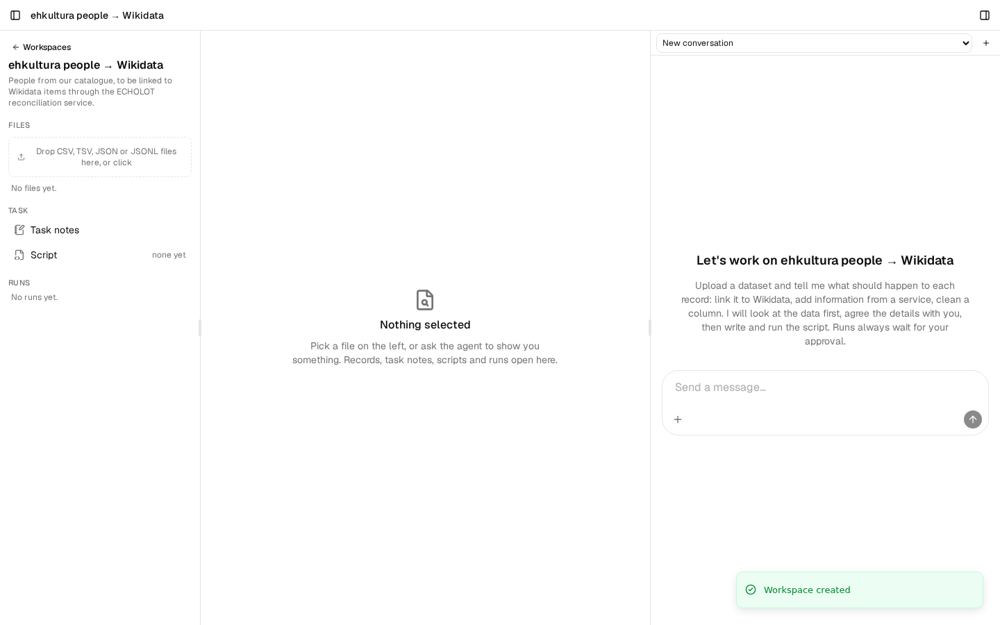 | **The empty workspace.** Upload area on the left, the chat on the right. |
| 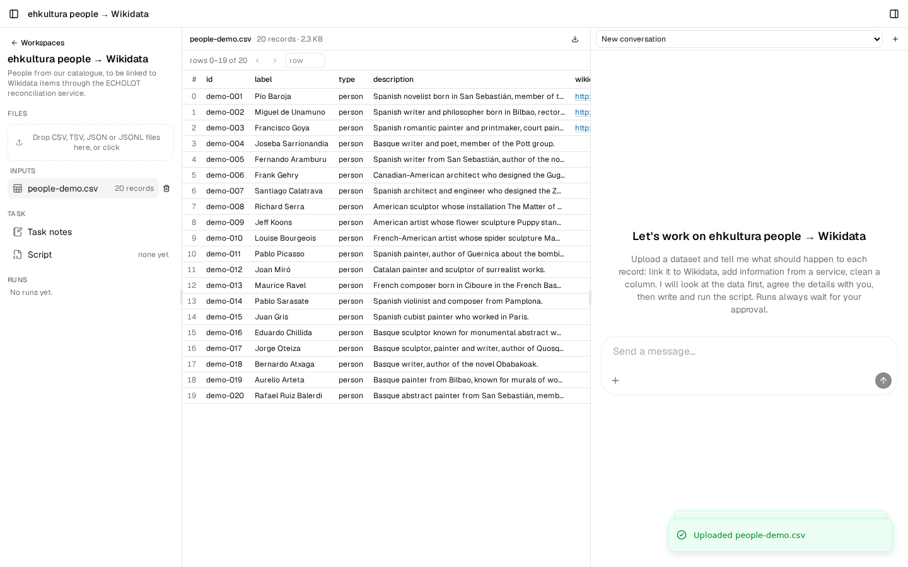 | **Upload a file.** A CSV, TSV, JSON or JSONL file becomes records; the middle pane pages through them, 50 at a time. Clicking a row tells the agent which row "this one" is. |

## 2. Agree with the agent what to do

| | |
|---|---|
| 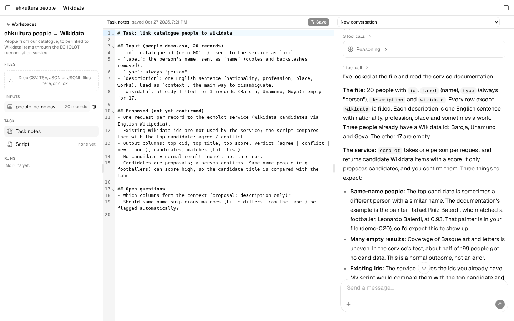 | **Ask.** "I'd like to link each of them to Wikidata. Can you have a look at the file first?" The agent profiles the file, samples records, reads the ECHOLOT documentation, explains what to expect (same-name people, empty results) and asks before doing anything. Its proposal goes into the task notes, open in the middle. |
| 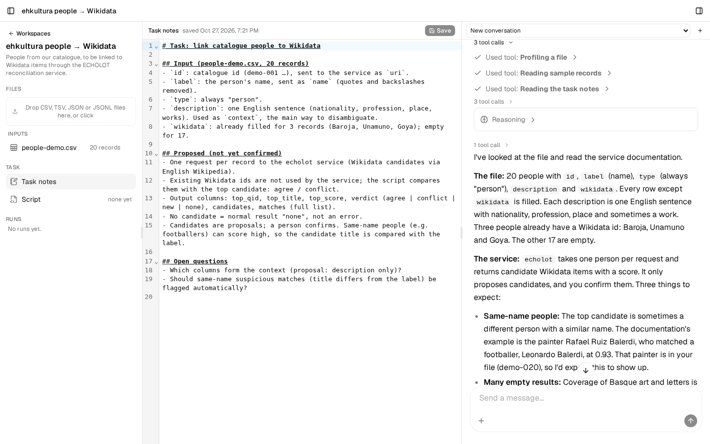 | **What it did.** Every tool call is listed and can be opened: here profiling the file, reading samples, reading the task notes. |
|  | **Task notes.** The agreed description of the work: which columns go in, what comes out, the rules, open questions. You can edit them; the agent sees your edits on its next turn. |

## 3. Script and sample

| | |
|---|---|
| 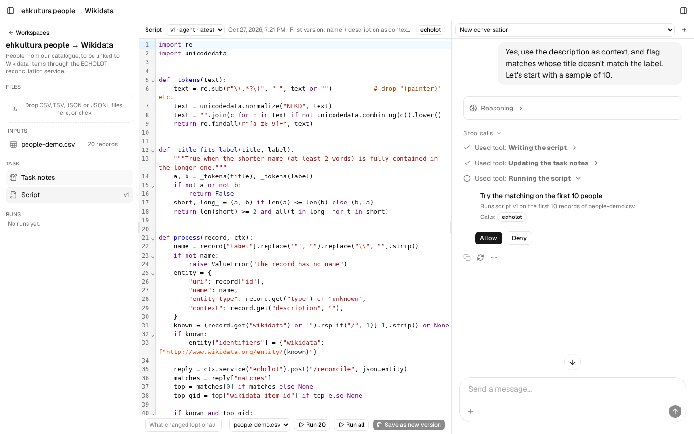 | **The script and the approval card.** After "Yes, use the description as context … start with a sample of 10", the agent writes the script (open in the middle) and asks to run it. The card says what will run: the purpose, the script version, how many records, and which services it calls. Nothing runs until you click Allow. |
| 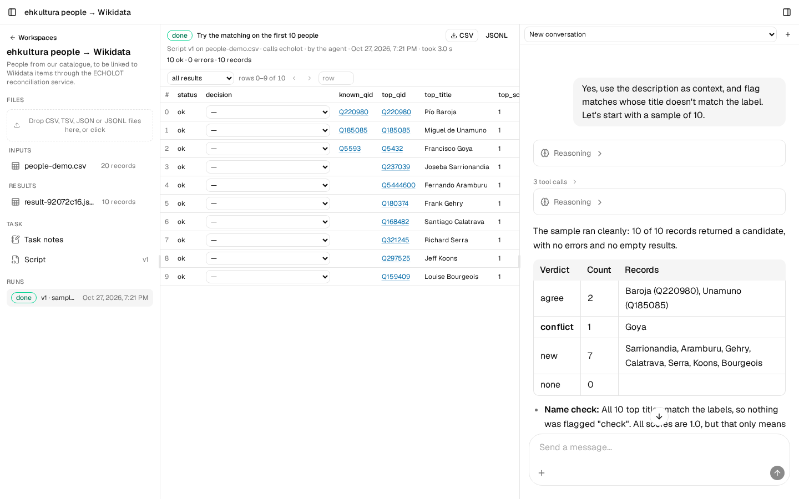 | **The sample.** The agent reports with counts and names: 2 agree with the existing Wikidata link, 1 conflict (Goya), 7 new. The run opens in the middle with each result next to its known QID. |
| 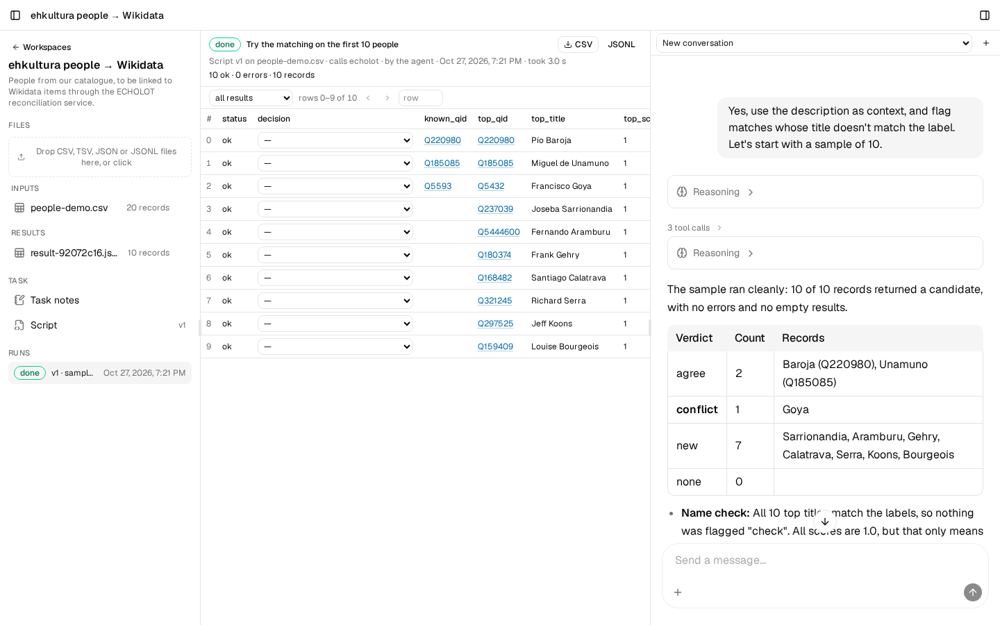 | **The sample run.** Status, who started it, how long it took, the results with linked QIDs. |
| 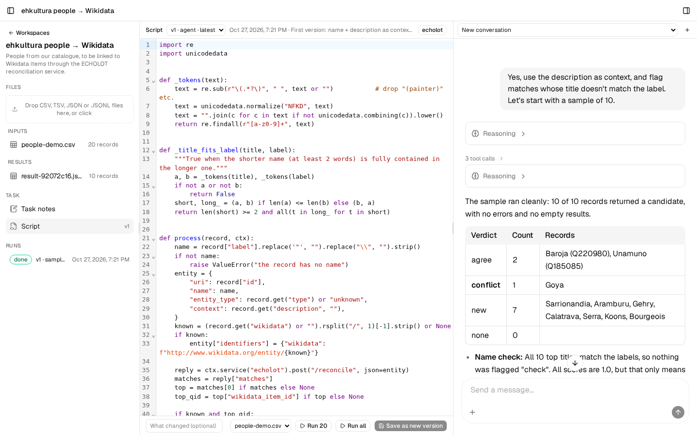 | **The script.** Versioned; you can read and edit it, save a new version, and run it yourself: "Run 20" or "Run all" on the chosen input file. A run you start here needs no approval card. |

## 4. Run everything and review

| | |
|---|---|
| 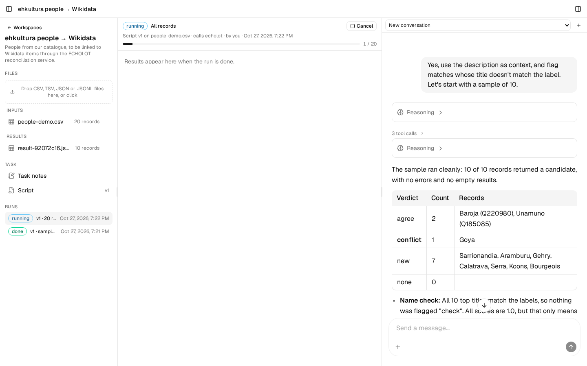 | **Run all.** Progress while the runner works through the records, four at a time, each one a call to ECHOLOT. It can be cancelled. |
| 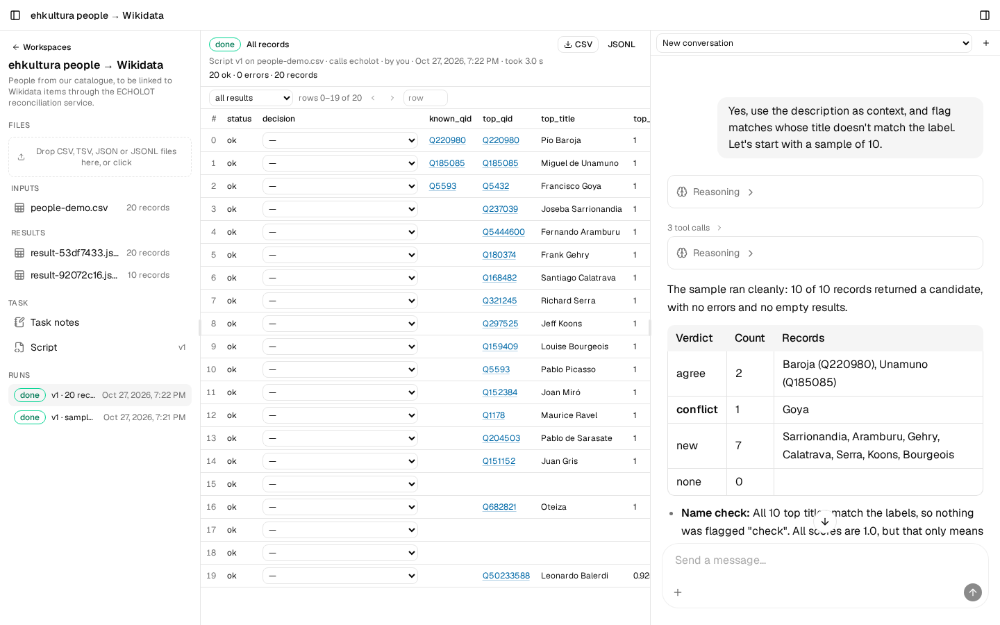 | **Results.** 20 records: confident matches, empty results (Chillida, Atxaga, Arteta) and confident wrong ones (Oteiza → "Oteiza", Rafael Ruiz Balerdi → the footballer Leonardo Balerdi at 0.92). Export as CSV or JSONL. |
| 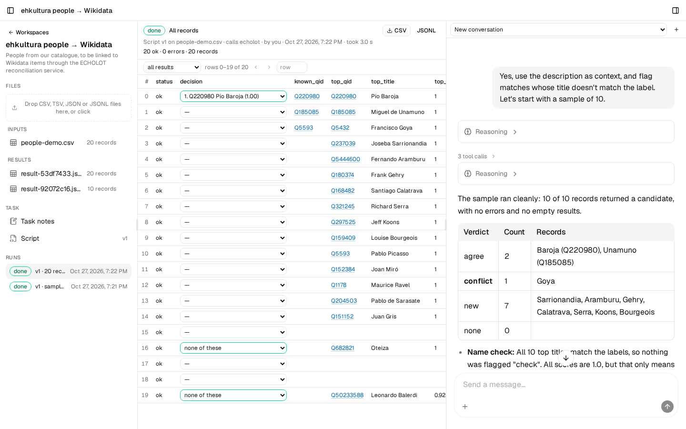 | **Decide per row.** Pick a candidate (Pío Baroja → Q220980) or "none of these" (Oteiza, Ruiz Balerdi). Decisions go into the export as a `decision` column. |
| 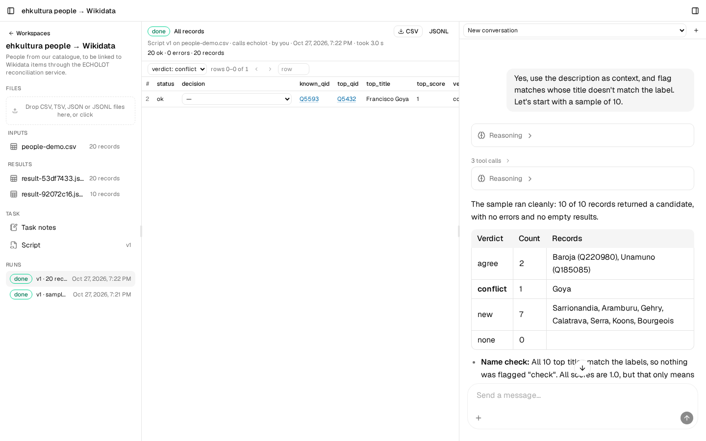 | **Filter.** By status, by decided or not, or by the script's verdict: here the one conflict, Goya, where the catalogue's Q5593 is in fact Picasso's QID. |
